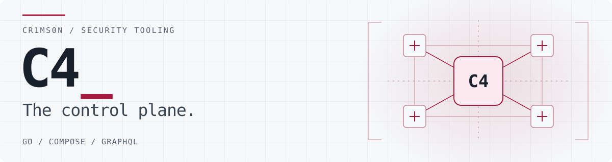

<picture>
  <source media="(prefers-color-scheme: dark)" srcset="assets/banner-dark.svg">
  <source media="(prefers-color-scheme: light)" srcset="assets/banner-light.svg">
  
</picture>

# C4 / C2 Control Center

**One interface for C2 infrastructure in adversary-emulation environments.**

C4 is a Go CLI for managing C2 infrastructure through Docker Compose and the Mythic GraphQL API. It brings configuration, instance status, and operator commands together without replacing the frameworks underneath.

`Go` `Docker Compose` `GraphQL`

[Get started](#get-started) · [Usage guide](docs/USAGE.md) · [Architecture](ARCHITECTURE.md) · [Contributing](CONTRIBUTING.md)

## What it does

### 01 / Manage the infrastructure

Start and stop an existing Mythic Compose installation. Check Mythic and configured exec-provider status from the same CLI. Generic exec providers run locally configured commands for other tools.

### 02 / Work through one interface

Inspect Mythic listeners, callbacks, and payloads through its GraphQL API. Discover installed C2 frameworks with `c4 detect` instead of maintaining a separate inventory by hand.

### 03 / Keep it scriptable

TOML configuration, YAML exec-provider definitions, verbose logging, and JSON **logs** fit existing operator workflows. Command results retain their own output formats; `--json` is a logging flag, not a universal JSON response mode.

**Current scope:** Mythic and generic exec providers are implemented; there is no dedicated Sliver provider. Mythic's `destroy` command is not yet implemented—use `c4 stop mythic` to stop its Compose project, not to erase its data. See the [command reference](docs/USAGE.md#command-reference) for provider-specific limits.

## Get started

Install with the Go toolchain required by [go.mod](go.mod):

```bash
go install github.com/CR1MS0N-Operator/c4@latest
c4 --help
c4 init
```

`c4 init` creates `~/.c4/c4.toml` and scans for installed frameworks; it does not install Mythic or configure its credentials. Docker Engine with Compose v2 is required for Mythic lifecycle commands. Before connecting, set the Mythic path, endpoint, admin secret, and [TLS trust](docs/USAGE.md#mythic-tls) in the generated configuration.

Once configured, inspect your instance:

```bash
c4 status mythic
```

[Continue to setup and usage →](docs/USAGE.md)

## Explore the project

| Start here | What you will find |
| --- | --- |
| [Usage guide](docs/USAGE.md) | Requirements, configuration, commands, and Mythic TLS |
| [Architecture](ARCHITECTURE.md) | Package layout, provider abstraction, and data flow |
| [Contributing](CONTRIBUTING.md) | Local development, checks, and commit conventions |
| [Changelog](CHANGELOG.md) | Release history |
| [Security](SECURITY.md) | Private vulnerability reporting |
| [Worktrees](WORKTREES.md) | Isolated development and dispatch workflow |

## Part of the toolset

C4 is the control-plane project in [Darrius Grate's security and systems work](https://github.com/CR1MS0N-Operator). The neighboring projects cover the environment, identity auditing, and research—not additional C4 features.

- **[NightForge](https://github.com/CR1MS0N-Operator/nightforge)** — The operator workstation and validation harness.
- **[Lant3rn](https://github.com/CR1MS0N-Operator/Lant3rn)** — Active Directory permission auditing.
- **[Research](https://github.com/CR1MS0N-Operator/security-research)** — Raw research and technical analysis.
- **[Azrael Security](https://azraelsecurity.vercel.app)** — The public portfolio and technical writeups.

---

<sub>Inspectable tooling. Repeatable workflows. Below the abstraction.</sub>

MIT — see [LICENSE](LICENSE).
